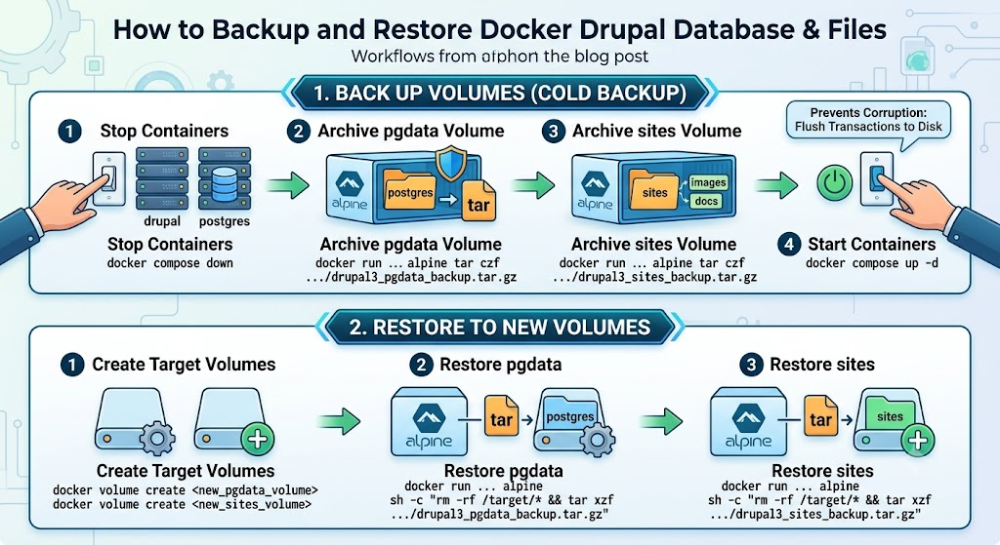

# How to Backup and Restore Docker Drupal Database & Files

{width="400"
query="?400"}

I plan to use the Drupal docker container heavily, and I want to back up
the data that I create for it.

## Docker Compose File

Below is the Drupal docker compose file:

``` yaml
# Database username: postgres
# Database password: example
# ADVANCED OPTIONS; Database host: postgres
#

version: '3.1'

services:

  drupal:
    image: my-drupal:latest
    ports:
      - 8080:80
    volumes:
      - modules:/var/www/html/modules
      - profiles:/var/www/html/profiles
      - themes:/var/www/html/themes
      # this takes advantage of the feature in Docker that a new anonymous
      # volume (which is what we're creating here) will be initialized with the
      # existing content of the image at the same location
      - sites:/var/www/html/sites
    restart: none

  postgres:
    image: postgres:16
    environment:
      POSTGRES_PASSWORD: example
    restart: none
    volumes:
      - pgdata:/var/lib/postgresql/data

volumes:
  modules:
  profiles:
  themes:
  sites:
  pgdata:
```

NOTE: The actual volume files are managed by Docker and are not stored
locally in the project directory. The most important data is stored in
the pgdata and sites volumes.

## 1. Back up Volumes

To prevent database corruption, bring your stack down first so all
pending database transactions are safely flushed to disk.

### Step 1: Stop and remove active containers

    docker compose down

### Step 2: Archive the pgdata volume

Run a temporary Alpine Linux container to archive the data.

    docker run --rm \
      -v drupal3_pgdata:/source:ro \
      -v $(pwd):/backup \
      alpine tar czf /backup/drupal3_pgdata_backup.tar.gz -C /source .

### Step 3: Archive the sites volume

Your uploaded files (images, PDFs, custom themes, etc.) reside in your
sites volume. Run the same process for this volume:

    docker run --rm \
      -v drupal3_sites:/source:ro \
      -v $(pwd):/backup \
      alpine tar czf /backup/drupal3_sites_backup.tar.gz -C /source .

### Step 4: Bring your stack back up

    docker compose up -d

## 2. Restore to New Volumes

Here's how to restore the archived volumes to new volumes:

### Step 1: Create new target volumes

    docker volume create <new_pgdata_volume>
    docker volume create <new_sites_volume>

### Step 2: Restore the pgdata volume

    docker run --rm \
      -v <new_pgdata_volume>:/target \
      -v $(pwd):/backup:ro \
      alpine sh -c "rm -rf /target/* && tar xzf /backup/drupal3_pgdata_backup.tar.gz -C /target"

### Step 3: Restore the Sites volume

    docker run --rm \
      -v <new_sites_volume>:/target \
      -v $(pwd):/backup:ro \
      alpine sh -c "rm -rf /target/* && tar xzf /backup/drupal3_sites_backup.tar.gz -C /target"

## References

- <https://www.youtube.com/watch?v=3JUqkyZCK88&t=129s>
- <https://stackoverflow.com/questions/79246538/simple-way-to-backup-restore-docker-named-volumes>
