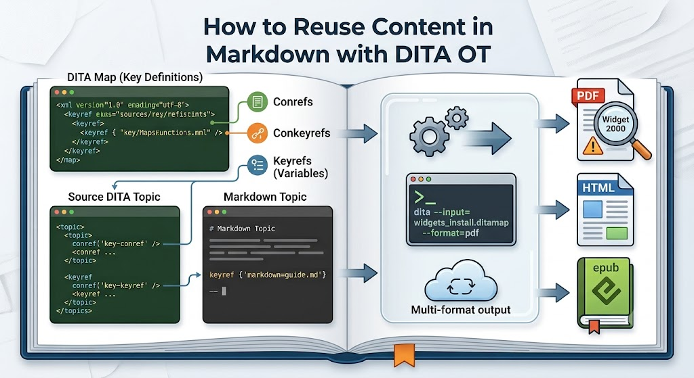
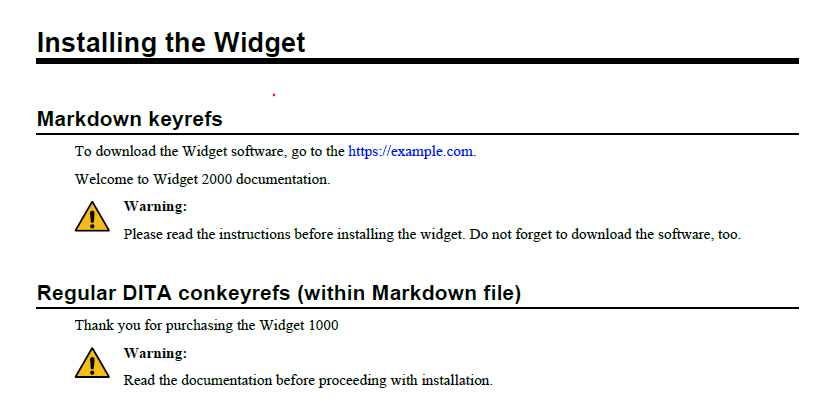

# How to Reuse Content in Markdown with DITA OT

{width="400" query="?400"}

You can use a DITA conref to reuse a block of text. For example, you can
refer to a safety warning or note where exact wording is crucial.
Conrefs also ensure consistent usage. If you're a technical writer, they
work similarly to text insets in FrameMaker; if you're a programmer,
think of them like code snippets.

You can use a content key reference (conkeyref) to reuse elements
indirectly. Instead of pointing directly to a specific file path (like a
standard conref), you point to a key definition configured in your DITA
map. This makes your content modular and easier to reuse across
different outputs or products.

Variables are a special application of keyrefs, often used for product
names. If two products are similar, you can reuse most of the content
and swap product names with variables.

The following examples show how to use reuse mechanisms (keyrefs and
conkeyrefs) in a Markdown file.

## 1. Set up Files to Enable Reuse

### a. widgets_install.ditamap

The following code shows key definitions for \`download-link\`,
\`product-name\`, and \`product-note\`, as well as a key setup for
\`widgets.dita\`.

``` xml
<?xml version="1.0" encoding="UTF-8"?>
<!DOCTYPE map PUBLIC "-//OASIS//DTD DITA Map//EN" "map.dtd">
<map id="install_guide">

<title>Widget Quick Install Guide</title>
<keydef keys="product_variables" href="widgets.dita" format="dita" type="topic"/>
<keydef keys="download-link" href="https://example.com" scope="external" format="html"/>
<keydef keys="product-name">
  <topicmeta>
    <keywords><keyword>Widget 2000</keyword></keywords>
  </topicmeta>
</keydef>
<keydef keys="product-note">
  <topicmeta>
    <keywords><keyword>Please read the instructions before installing the widget. Do not forget to download the software, too.</keyword></keywords>
  </topicmeta>
</keydef>

<topicref href="installation_guide.md" format="markdown"/>
</map>
```

### b. widgets.dita

This file contains the target elements referenced indirectly by
\`widgets_install.ditamap\`.

``` xml
<?xml version="1.0" encoding="UTF-8"?>
<!DOCTYPE topic PUBLIC "-//OASIS//DTD DITA Topic//EN" "topic.dtd">
<topic id="widgets">
  <title>Product Info</title>
  <body>
    <p id="preinstall_warning">Read the documentation before proceeding with installation.</p>
    <p><ph id="product_name">Widget 1000</ph></p>
  </body>
</topic>
```

### c. installation_guide.md

The following Markdown file shows keyrefs from the
\`widgets_install.ditamap\` for \`download-link\`, \`product-name\`, and
\`product-note\`.

It also shows conkeyrefs to \`product_variables/product_name\` and
\`product_variables/preinstall_warning\` using standard DITA format
instead of Markdown format.

``` markdown
# Installing the Widget

## Markdown keyrefs

To download the Widget software, go to the [download-link].

Welcome to [product-name] documentation.

!!! warning
    [product-note]


## Regular DITA conkeyrefs (within Markdown file)

<p>Thank you for purchasing the <ph conkeyref="product_variables/product_name"/>.</p>

<note type="warning">
<p conkeyref="product_variables/preinstall_warning"/>
</note>
```

## 2. Show Results

Run the following DITA OT command:

``` bash
dita --input=widgets_install.ditamap --format=pdf
```

### a. PDF File

{width="400"
query="?400"}
