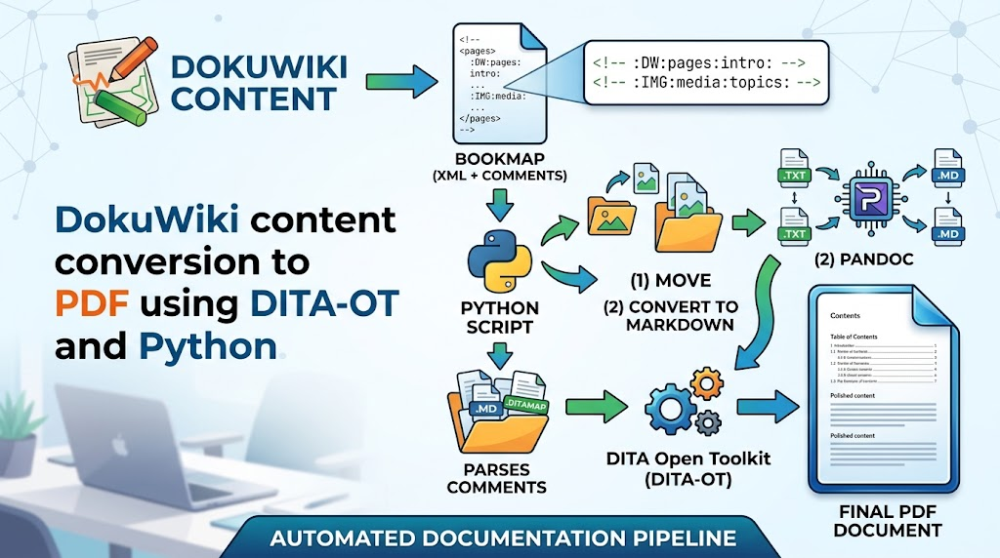
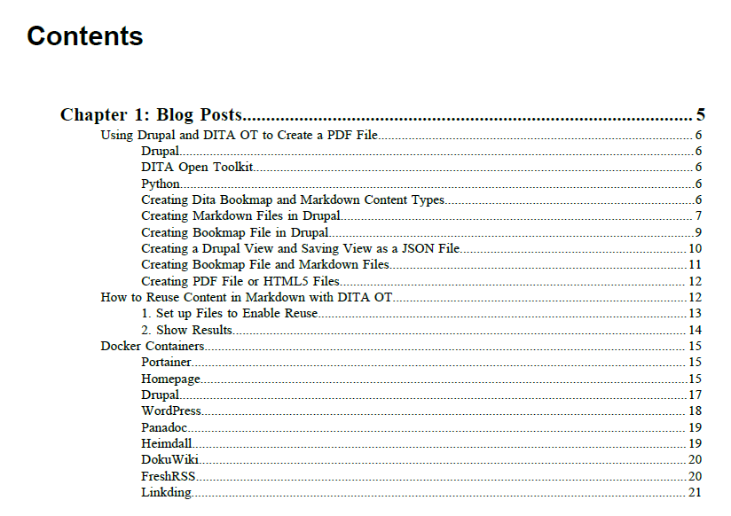

# DokuWiki Content Conversion to PDF Using DITA-OT and Python

{width="400"
query="?400"}

I rely heavily on DokuWiki for creating blog posts and taking notes for
coding and command line entries. It is very easy to use and offers many
extensions. See my previous post DokuWiki for setting up DokuWiki.

While DokuWiki extensions can generate PDFs, combining multiple posts
into a single document is difficult. This is where DITA Open Toolkit
(DITA OT) comes in. DITA excels at combining files and generating clean
tables of contents.

Since DITA OT requires Markdown, I use Pandoc to convert the DokuWiki
files into Markdown files. Below is the workflow for using a DITA
bookmap to combine and generate the final PDF.

## 1. Create a Bookmap File in DokuWiki

This page contains XML configuration and special comments that tell the
Python script how to process images and files. Create it in DokuWiki
inside ''

'' tags (e.g., at `ditamap:blogs`).

    <code>
    <?xml version='1.0' encoding='utf-8'?><!DOCTYPE bookmap PUBLIC "-//OASIS//DTD DITA BookMap//EN" "../dtd/bookmap/dtd/bookmap.dtd">
    <bookmap id="test1">
    <booktitle>
    <booklibrary>Blog Posts</booklibrary>
    <mainbooktitle>Compilation of Posts</mainbooktitle>
    <booktitlealt>By: Eric Strausbaugh</booktitlealt></booktitle>
    <frontmatter>
    <booklists><toc/></booklists>
    </frontmatter>

    <!-- :IMG:html/data/media/drupal:topics/drupal: -->
    <!-- :IMG:html/data/media/dita:topics/dita: -->
    <!-- :IMG:html/data/media/docker:topics/docker: -->

    <!-- :DW:html/data/pages/blogs:intro: -->
    <chapter href="topics/intro.md" format="markdown">
    <!-- :DW:html/data/pages/drupal:drupal_dita_pdf: -->
     <topicref href="topics/drupal_dita_pdf.md" format="markdown"></topicref>
    <!-- :DW:html/data/pages/dita:conref: -->
      <topicref href="topics/conref.md" format="markdown"></topicref>
    <!-- :DW:html/data/pages/docker:containers: -->
      <topicref href="topics/containers.md" format="markdown"></topicref>
    </chapter>
    </bookmap>
     </code > 

- Comment syntax to copy images from `html/data/media/drupal` to
  `topics/drupal`:

<!-- -->

    <!-- :IMG:html/data/media/drupal:topics/drupal: -->

- Comment syntax to convert a DokuWiki file
  (`html/data/pages/blogs/intro.txt`) to Markdown (`topics/intro.md`).
  **Note:** Omit the file extensions in the comment.

<!-- -->

    <!-- :DW:html/data/pages/blogs:intro: -->

## 2. Create Python Conversion Script

Use the Python script below to parse the comments, move image files,
convert pages to Markdown, and clean up links.

``` python
import os, subprocess, sys, shutil, glob, re


# Path to ditamap in DokuWiki 
ditamap = sys.argv[1]
# Path to output the ditamap file with the code tags stripped out
ditamap_out = sys.argv[2]

# Open the source file for reading and the destination file for writing
with open(ditamap, 'r', encoding='utf-8') as infile, \
     open(ditamap_out, 'w', encoding='utf-8') as outfile:
    
    # Loop through the source file line by line
    for line in infile:
        if "code>" not in line:
            # Write the line directly to the destination file
            outfile.write(line)

with open(ditamap, "r") as file:
    for line in file:
        # Copy the images files to a common location
        if "IMG" in line and "!--" in line:
            item = line.split(":")
            source_dir = item[2]
            destination_dir = item[3]

            # Ensure the destination folder exists before copying
            os.makedirs(destination_dir, exist_ok=True)

            # Find all files with an extension inside the source directory (*.*)
            # Change to "/**/*.*" and add recursive=True if you want to search subfolders too
            files_to_copy = glob.glob(os.path.join(source_dir, "*.*"))

            for file_path in files_to_copy:
                if os.path.isfile(file_path):  # Double-check it's a file, not a folder
                    shutil.copy(file_path, destination_dir)

            print(f"Copied {len(files_to_copy)} files to {destination_dir}")
        # Convert the DokuWiki files to Markdown files
        if "DW" in line and "!--" in line:
            #print(line.strip())
            item = line.split(":")
            #print(f"{item[1]}  {item[2]} {item[3]}")
            input_file=item[2] + "/" + item[3] + ".txt"
            output_file="topics/" + item[3] + ".md"

            print(f"Input file: {input_file}")
            print(f"Output file: {output_file}")

            
            # Construct the Docker command
            cmd = [
                "docker", "run", "--rm",
                "-v", f"{subprocess.list2cmdline([subprocess.os.getcwd()])}:/data",
                "pandoc/core",
                "-f", "dokuwiki",
                "-t", "markdown",
                input_file,
                "-o", output_file
            ]
           
            # Run the command
            result = subprocess.run(cmd, capture_output=True, text=True)

            if result.returncode == 0:
                print("Conversion successful!")
            else:
                print("Error:", result.stderr)


directory_path = "topics"

#Perform cleanup

# Matches only text files in the target directory
search_pattern = os.path.join(directory_path, "*.md")

for file_path in glob.glob(search_pattern):
    print(f"Processing text file: {file_path}")

    # Step 1: Read the file contents
    with open(file_path, "r") as file:
        lines = file.readlines()

    # Step 2: Overwrite the file with modified content
    with open(file_path, "w") as file:
        for line in lines:
            # Example: Replace the word 'old' with 'new'
            #print(line)
            
            # remove leading /
            updated_line = line.replace("png](", "png](")
            updated_line = updated_line.replace("jpg](", "jpg](")
            # remove top-level directory (flat file structure for md topics). Update as needed.
            if "](" in updated_line and "png" not in updated_line and "jpg" not in updated_line:
                updated_line = updated_line.replace("](", "](".md)
                updated_line = updated_line.replace("](", "](".md)
                updated_line = updated_line.replace("](", "](".md)
                updated_line = updated_line.replace(")", ".md)")
            
            file.write(updated_line)     
```

## 3. Run the Python Conversion Script

Note: Activate your Python virtual environment first.

Run the conversion script by passing the source DokuWiki bookmap path
and the desired output `.ditamap` filename.

``` bash
sudo python3 convert.py  html/data/pages/ditamap/blogs.txt blogs.ditamap
```

- `html/data/pages/ditamap/blogs.txt` - Path to the source DokuWiki
  bookmap file.
- `blogs.ditamap` - Output `.ditamap` filename.

## 4. Run DITA OT Command to Create PDF File

    ~/dita-ot-4.4/bin/dita --input=blogs.ditamap --format=pdf --output=out

[Table of contents from blogs.pdf file]{.underline}

{width="400"
query="?400"}
