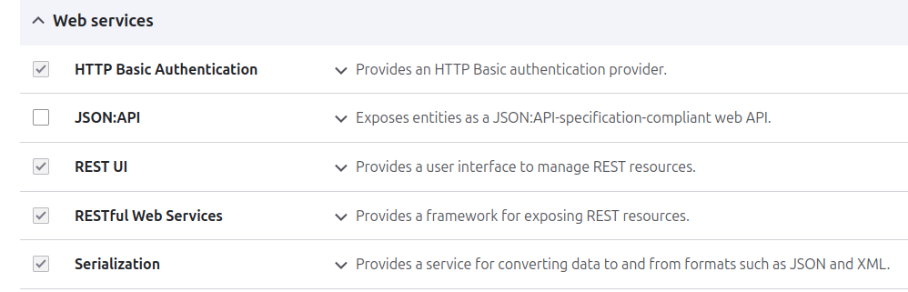
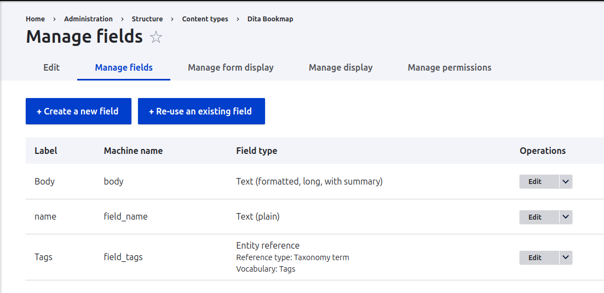
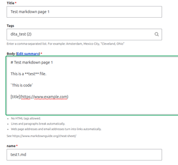
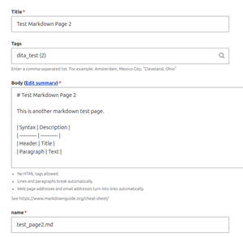
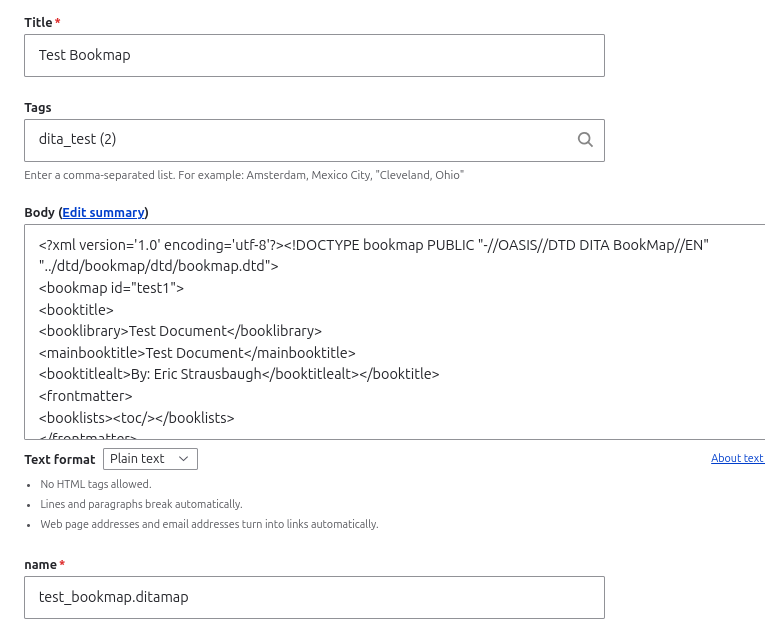
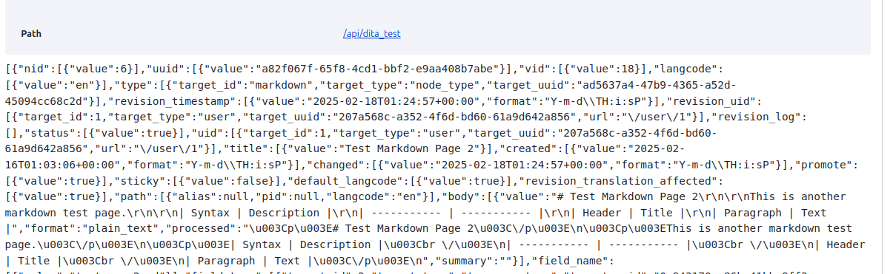

# Using Drupal and DITA OT to Create a PDF File

This post shows you how to use Drupal and DITA OpenToolkit to create a
PDF file. It uses Views in Drupal and the REST UI to create a json file
that will be used to create a bookmap and markdown files. These files
will be used by Open Toolkit to create a PDF file.

*Prerequisites:* Drupal, DITA OT, Python

## Drupal

Drupal can be a little tricky to install. It requires a web server, like
Apache, PHP, and and some sort of database, usually mysql or MariaDB is
used. I am using Drupal 10.4.2 on an Ubuntu 24.04.2 LTS operating
system.

Below are some possible ways to install Drupal (pulled from a Google
search):

<https://www.drupal.org/docs/getting-started/installing-drupal>

<https://www.drupal.org/docs/develop/local-server-setup/windows-development-environment/installing-drupal-with-ddev-in-wsl2-on-windows/installing-wsl2-ubuntu>

<https://www.simpleinformation.com/article/setup-drupal-10-ubuntu-20-minutes>

<https://www.digitalocean.com/community/tutorials/how-to-install-drupal-on-an-ubuntu-14-04-server-with-apache>

<https://www.drupal.org/docs/develop/local-server-setup/windows-development-environment/using-xampp/quick-install-drupal-with-xampp-on-windows>

<https://www.digitalocean.com/community/tutorials/how-to-install-drupal-with-docker-compose>

Make sure that the following modules are installed in Drupal:

{width="400"
query="?400"}

## DITA Open Toolkit

DITA Open Toolkit is really easy to install. You just have to unzip a
zip file. It does require that you have Java installed. I am using
OpenJDK version 21.0.6.

For DITA Open Toolkit, you can use markdown files instead of DITA files.
For this post we will use markdown files, which are much easier to work
with. DITA files require that you are familiar with fairly complex
tagging. Markdown is much easier to use. See the following website for a
markdown cheatsheet: [Markdown Cheat
Sheet](https://www.markdownguide.org/cheat-sheet/.md)

## Python

If you using a Linux system, Python should already be installed. See
<https://www.python.org/downloads/> to install on other operating
systems.

## Creating Dita Bookmap and Markdown Content Types

We will create a Dita bookmap and two markdown files. First, let's make
two new Content Types in Drupal.

For the first content type, perform the following steps:

1.  Select **Structure \> Content Types \> Add Content Type** from the
    Administrator menu.
2.  For the Name, enter: **markdown**.
3.  For Description, enter: "Use markdown for creating markdown file."
4.  Add the fields as shown below. You can Re-use an existing field for
    Tags.
    {width="400"
    query="?400"}
5.  Edit the Body field and make sure Body is set to allow Plain text.

For the second content type, perform the following steps:

1.  Select **Structure \> Content Types \> Add Content Type** from the
    Administrator menu.
2.  For the Name, enter **Dita Bookmap**.
3.  For Description enter: "Use Dita Bookmap for creating a Dita
    bookmap."
4.  Add the fields as shown below. You can Re-use an existing field for
    Tags.
    {width="400"
    query="?400"}
5.  Edit the Body field and make sure Body is set to allow Plain text.

## Creating Markdown Files in Drupal

Next, we will create the two markdown files. For the first file, perform
the following steps:

1.  Select **Content \> Add Content \> markdown**.
2.  For the Name, enter: **Test markdown page 1**
3.  Enter the following information:

{width="300"
query="?300"}

For the Body field, enter the following text:

    # Test markdown page 1

    This a **test** file.

    [title](https://www.example.com.md)

For the second file, perform the following steps:

1.  Select **Content \> Add Content \> markdown**.
2.  For the Name, enter: **Test markdown page 2**
3.  Enter the following information:

{width="300"
query="?300"}

For the Body field, enter the following text:

    # Test markdown page 2

    This is another markdown page.

    |Syntax   |Description|
    |---------|-----------|
    |Header   |Title |
    |Paragraph| Text |

## Creating Bookmap File in Drupal

Let's create the bookmap file next.

1.  Select **Content \> Add Content \> Dita Bookmap**..
2.  For the Name, enter: **Test Bookmap**
3.  Enter the following information:

{width="400"
query="?400"}

For Body field, enter the following information:

``` xml
<?xml version='1.0' encoding='utf-8'?><!DOCTYPE bookmap PUBLIC "-//OASIS//DTD DITA BookMap//EN" "../dtd/bookmap/dtd/bookmap.dtd">
<bookmap id="test1">
<booktitle>
<booklibrary>Test Document</booklibrary>
<mainbooktitle>Test Document</mainbooktitle>
<booktitlealt>By: Eric Strausbaugh</booktitlealt></booktitle>
<frontmatter>
<booklists><toc/></booklists>
</frontmatter>
<chapter href="test1.md" format="markdown">
 <topicref href="test_page2.md" format="markdown"></topicref>
</chapter>
</bookmap>
```

## Creating a Drupal View and Saving View as a JSON File

The following step shows how to make a view using the dita_test tags
that we applied above.

1.  Select **Structure \> Views \> Add View**.
2.  Enter **dita_test** for the View Name.
3.  Select **Create Page** and use the default settings.
4.  Click on **Provide a Rest Export** and chose **api/dita_test** as
    the Rest Export Path.
5.  Click **Save and Edit**.
6.  Click on the **Edit** button for the dita_test view.
7.  Click on **Add** under Filter Criteria.
8.  Click on **Tags** (field_tags).
9.  Click **Apply**.
10. Click **Apply and Continue**.
11. For Operator, select Is one of and enter dita_test.
12. For Access \> Access restrictions: Select **Role**
13. For Access \> Access options: Select **Authenticated User**
14. Click **Apply**.
15. Click on the **Rest export display**.
16. Under Formats, click on **Settings**.
17. Select **json** as the Accepted request formats and click **Apply**.
18. Under Authentication, choose **Basic_Auth**
19. Click Save.

The Preview should look similar to the following:

{width="400" query="?400"}

To save the view as a JSON file:

1.  Navigate to the view that you created (e.g.,
    <http://localhost/api/dita_test>). NOTE: You may need to open the
    view as New Incognito Window.
2.  Login with your admin login and password.
3.  In the view, right click and select **Save As...** (choosing
    **dita_test.json** as filename).

## Creating Bookmap File and Markdown Files

The following steps will create the bookmap file and markdown files from
the **dita_test.json** file by using a Python script:

1.  Create a directory (e.g., **python_drupal**).
2.  Change directory to the directory that you created.
3.  Copy the **dita_test.json** to this directory.
4.  Create a file named **json_to_dita.py**.
5.  Paste the following contents into the file. Then, run
    `python3 json_to_dita.py`

``` python
import json
import requests
import os

with open('dita_test.json', 'r') as file:
    data = json.load(file)

length= len(data)
print(length)

directory_name = "out"
# Create the directory
try:
    os.mkdir(directory_name)
    print(f"Directory '{directory_name}' created successfully.")
except FileExistsError:
    print(f"Directory '{directory_name}' already exists.")
except PermissionError:
    print(f"Permission denied: Unable to create '{directory_name}'.")
except Exception as e:
    print(f"An error occurred: {e}")

for x in range(length):
    if data[x]['field_tags'][0]['target_id'] is not None:
        file1 = open(directory_name + "/" + data[x]['field_name'][0]['value'], "w")
        file1.write(data[x]['body'][0]['value'])
        print(data[x]['vid'][0]['value'])
        print(data[x]['body'][0]['value'])
        print(data[x]['field_name'][0]['value'])
        file1.close() 
```

This creates the bookmap and markdown files that you created in previous
steps in the **out** directory.

## Creating PDF File or HTML5 Files

Within the directory where the bookmap and markdown files reside, run:

      ~/dita-ot-x.x/bin/dita --input=test_bookmap.ditamap --format=pdf --output=out

or

      ~/dita-ot-x.x/bin/dita --input=test_bookmap.ditamap --format=html5 --output=out 

**NOTE:** DITA-OT must be installed to run the commands above. See
<https://www.dita-ot.org/dev/topics/installing> for installation
instructions.
